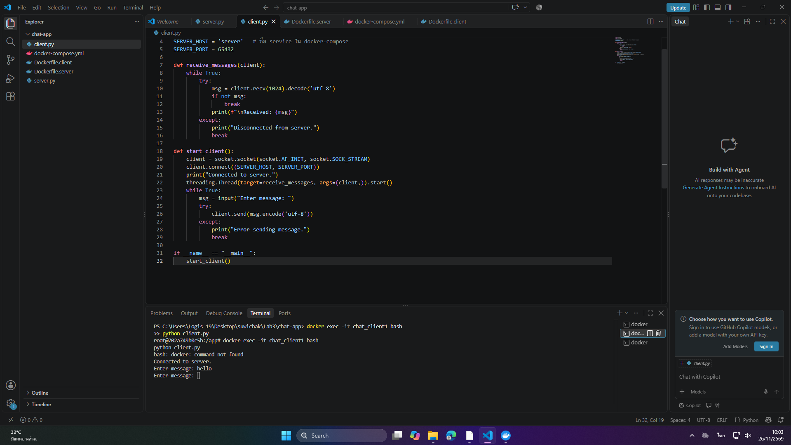
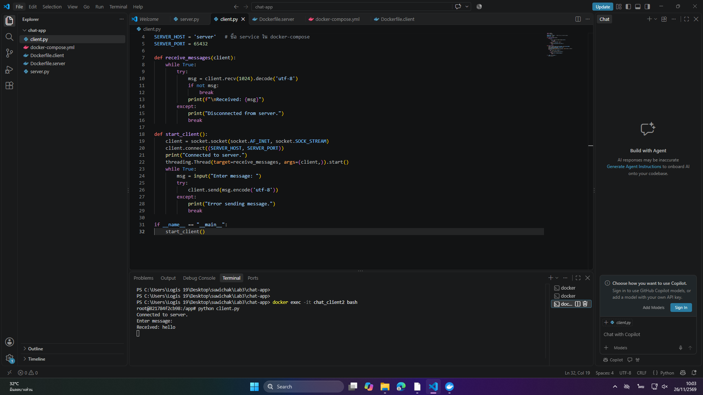
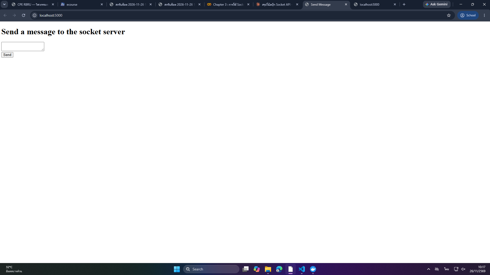
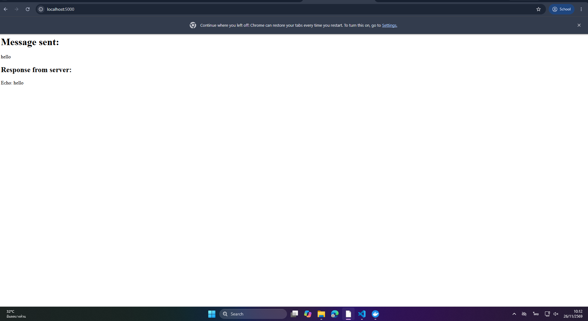
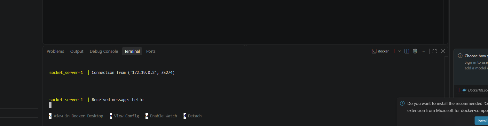
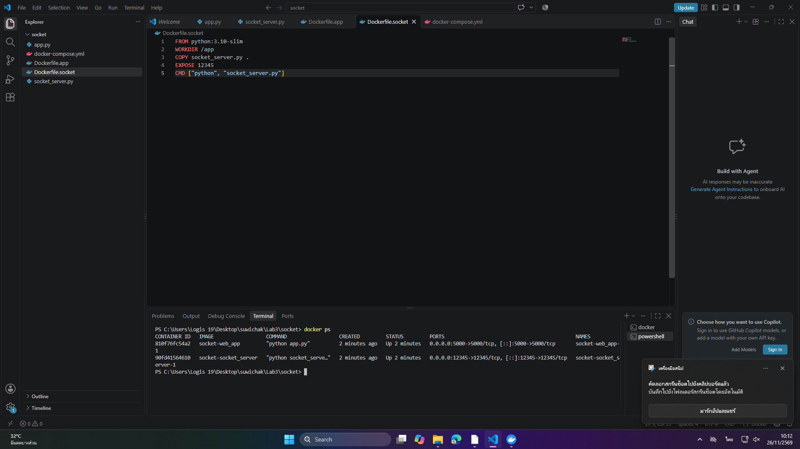
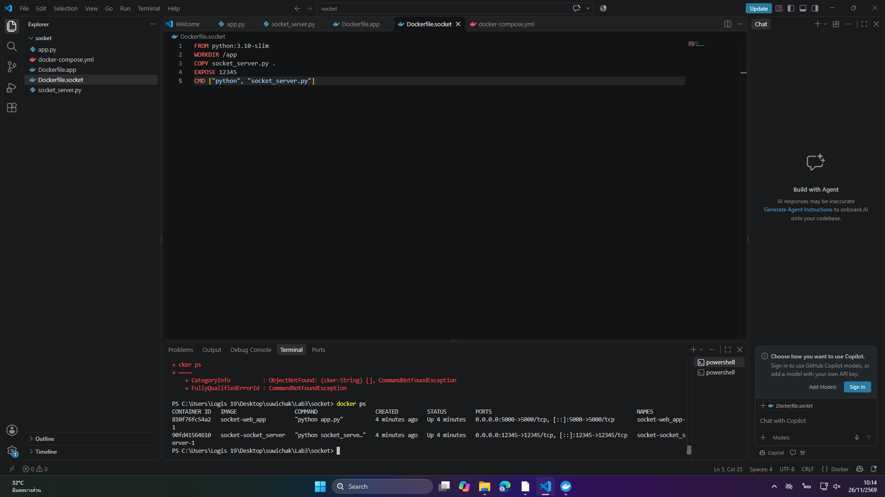

# แบบฝึกหัด Socket API & Docker

**ข้อมูลผู้จัดทำ**
- ชื่อ-นามสกุล: สุวิจกขณ์ ไผ่แจ้ตามูล
- รหัสนักศึกษา: 6814952028
- กลุ่ม/เซกชัน: 2

---

## แบบฝึกหัดที่ 1: ระบบ Chat ด้วย Docker (2 Clients & 1 Server)

### คำอธิบายการทำงาน
ระบบแชตใช้ Socket API แบบ TCP โดยมี Server ตัวเดียวรับข้อความจาก Client แล้วกระจาย (broadcast) ไปยัง Client ตัวอื่น ทั้ง Server และ Client รันแยกกันใน Docker Container ผ่าน Docker Compose

### วิธีรัน
```bash
cd my-socket-assignment/exercise-1
docker compose up --build
docker exec -it chat_client1 bash
python client.py
```
(ทำเช่นเดียวกันกับ `chat_client2` ในอีก Terminal)

### ผลลัพธ์
Client 1



Client 2



---

## แบบฝึกหัดที่ 2: เว็บแอป Flask ส่งข้อความไป Socket Server

### คำอธิบายการทำงาน
ผู้ใช้กรอกข้อความในฟอร์มบนหน้าเว็บ (Flask) ด้วย POST method จากนั้น Flask ส่งข้อความไปยัง Socket Server ผ่าน Socket API แล้วรับคำตอบ (Echo) กลับมาแสดงบนหน้าเว็บ แยกเป็น 2 คอนเทนเนอร์: `web_app` และ `socket_server`

### วิธีรัน
```bash
cd my-socket-assignment/exercise-2
docker compose up --build
```
เปิดเบราว์เซอร์ไปที่ http://localhost:5000

### ผลลัพธ์
หน้าฟอร์ม



หน้าผลลัพธ์





docker ps



Log ของ Socket Server



---

## ข้อกำหนดเบื้องต้น
- ติดตั้ง Docker Desktop
- ติดตั้ง WSL (สำหรับ Windows)
